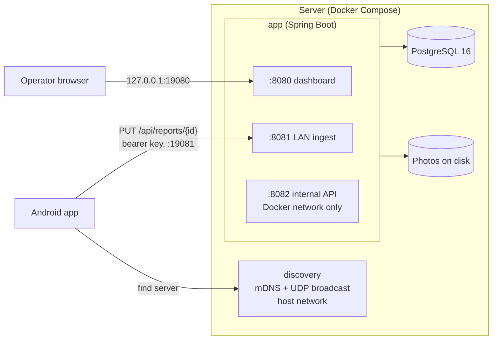

# ehz-backend

On-premise backend for [`ehz-diagnostics-tracker`](https://github.com/thedioxider/ehz-diagnostics-tracker), an Android app used to inspect the electrochemical (corrosion) protection of gas pipelines in the field. Phones on the local network upload finished inspection reports here. The service stores them in PostgreSQL, saves photos to disk, and serves a read API for admin tools.

It is meant to be installed by a non-technical operator on an offline machine: one `docker compose up -d`, and phones find the server on their own with nothing to configure.

## Install from ZIP (air-gap)

Two platform ZIPs are published with each release:
`ehz-backend-<VER>-linux.zip` and `ehz-backend-<VER>-windows.zip`.

Download the appropriate ZIP on a connected machine, transfer it to the target,
verify, and run the setup script. See `ИНСТРУКЦИЯ.md` inside the ZIP.

## Data

All persistent data lives in Docker named volumes (`ehz_pgdata`, `ehz_appdata`).
Backup and restore via the scripts in `tools/` inside the release ZIP, or
`linux/backup.sh` / `windows/backup.ps1` in the repo.

## Development

```sh
docker compose -f docker-compose.yml -f docker-compose.dev.yml up --build   # build from source and run
./gradlew test                              # needs a running Docker daemon
./gradlew :app:regenOpenApiSpec             # regenerate docs/api-contract-*.yaml
./gradlew release -Pehz.version=<ver>       # images + build/release/ehz-backend-<ver>-{linux,windows}.zip
```

`bootRun` is disabled; local runs go through Compose. Docker builds use BuildKit cache mounts, so repeated builds reuse the Gradle cache.

## Highlights

- **No setup on the phones.** The server announces itself over mDNS and answers UDP broadcasts, so the app finds it on its own. The operator dashboard shows the API key as a QR code for pairing.
- **Access control by port, without Spring Security.** One JVM runs three Tomcat connectors, each exposed differently (see [Network](#network)). A servlet filter allows only three endpoints on the LAN port, returns 404 for every other path, and compares the key in constant time.
- **Retry-safe uploads.** `PUT /api/reports/{id}` replaces the whole report in one transaction (201 on the first upload, 200 after), so the app can safely retry. Photos arrive as base64 and are written to disk atomically, with a check that file paths can't escape the photos directory.
- **Explicit API versioning.** Every `/api/**` response, errors included, carries an `X-Contract-Version` header. The app refuses to sync with an incompatible server.
- **OpenAPI from code.** API specs are generated from the running app, and a test fails if the committed `docs/api-contract-*.yaml` files are out of date.
- **Offline release bundle.** One Gradle task builds the Docker images and packages Linux and Windows ZIPs. Each contains the image tarballs, setup/backup/restore/reset scripts, operator instructions and SHA-256 checksums.
- **Tests against real Postgres.** 43 tests with JUnit 5, MockMvc and Testcontainers (PostgreSQL 16).

## Architecture



### Network

| Container port     | Published as      | Used by                                                                            | Access                                                                                                                                 |
| ------------------ | ----------------- | ---------------------------------------------------------------------------------- | -------------------------------------------------------------------------------------------------------------------------------------- |
| 8081               | `<lan-ip>:19081`  | Android app                                                                        | `GET /api/ping` and `GET /api/info` are open. `PUT /api/reports/{id}` needs the bearer key (401 otherwise). Any other path returns 404 |
| 8080               | `127.0.0.1:19080` | Operator dashboard: server address, health, report counts, API key and its QR code | Reachable only from the server machine itself                                                                                          |
| 8082               | not published     | Future admin frontend on the Docker network                                        | None. Only containers on the Docker network can reach it                                                                               |
| 5353/udp, 5370/udp | host network      | `discovery` service                                                                | None                                                                                                                                   |

`discovery` is a separate container with host networking. Docker's bridge network doesn't reliably pass broadcast and multicast traffic, and the app always looks for the server on port 5370, so that port can't be remapped.

## API

| Endpoint                                                 | Port          | Purpose                                                           |
| -------------------------------------------------------- | ------------- | ----------------------------------------------------------------- |
| `GET /api/ping`, `GET /api/info`                         | LAN, internal | Health check; build and API contract version                      |
| `PUT /api/reports/{id}`                                  | LAN           | Upload or replace a report                                        |
| `GET /api/reports`                                       | internal      | Paged list; filters `from`, `to`, `route`, `section`, `inspector` |
| `GET /api/reports/{id}`                                  | internal      | Report with sites and fields                                      |
| `GET /api/photos/{reportId}/{siteId}/{specId}.webp`      | internal      | Photo file                                                        |
| `GET /api/config/areas`, `GET /api/config/report-config` | internal      | Routes and sections, and the field config, as YAML                |

The committed specs are `docs/api-contract-lan.yaml` and `docs/api-contract-internal.yaml`. Swagger UI is served at `/swagger-ui/index.html` on the internal port.

## Data model

Routes contain sections. A report belongs to a section and holds sites, and each site holds fields (`routes` -> `sections` -> `reports` -> `sites` -> `report_fields`). A separate `devices` table records which phone sent each report, using the `X-Device-Id` header.

- Every table uses UUID primary keys. Timestamps are `TIMESTAMPTZ`, and uploads must send them as ISO-8601 strings.
- Liquibase manages the schema (`schema.sql`). Hibernate only checks that the schema matches (`ddl-auto=validate`).
- A route or section is created by the first report that mentions it. Later reports never overwrite it.

## Tech stack

Kotlin 2.2 on JVM 21, Spring Boot 4 (Web MVC, Data JPA / Hibernate, Validation, Actuator, Thymeleaf), Jackson 3, PostgreSQL 16, Liquibase, springdoc-openapi, ZXing, JmDNS, kotlinx.serialization, JUnit 5, Testcontainers, Gradle (Kotlin DSL, multi-module), Docker Compose.

## Project structure

```
app/                          Spring Boot service
  src/main/kotlin/space/diomentia/ehzbackend/
    ApiContract.kt            API contract version and header name
    InfoController.kt         /api/ping, /api/info
    bootstrap/                API key generation and storage
    catalog/                  routes, sections; YAML config endpoints
    config/                   filters (contract version, LAN auth), LAN connector, Jackson, OpenAPI
    dashboard/                operator dashboard on the management port
    devices/                  device tracking filter and upsert
    reports/                  Report -> Site -> ReportField: upload and query
      dto/                    upload and view DTOs, kept separate from entities
      photos/                 photo storage on disk and its GET endpoint
  src/main/resources/
    db/changelog/             Liquibase changelog
    seed/report_conf.yaml     default field config served to clients
    templates/dashboard.html
  src/test/                   integration tests (Testcontainers)
discovery/                    standalone mDNS announcer and UDP responder (fat JAR)
gradle/release.gradle.kts     release pipeline: images, platform ZIPs, GitHub release
linux/, windows/              operator scripts (setup, backup, restore, reset) and instructions
docs/                         generated OpenAPI specs
docker-compose.yml            operator stack (prebuilt images)
docker-compose.dev.yml        overlay that builds the images from source
VERIFICATION.md               end-to-end smoke test runbook
```

Packages are organized by feature. A sub-package is split out only when it has a clearly separate job, e.g. `reports/photos` has its own storage (the filesystem) and its own URLs.
